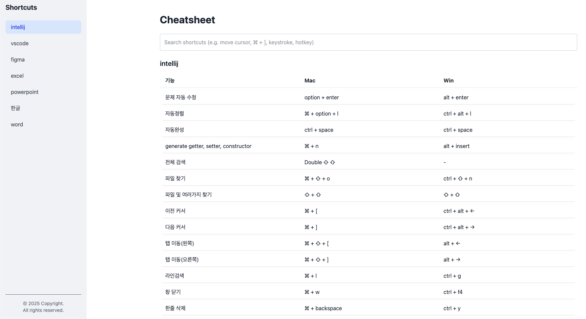

# Shortcut Cheatsheet

[](https://github.com/ydj515/shortcut-cheatsheet/actions/workflows/sync-dev-standards.yml)
[](./mise.toml)
[](./package.json)
[](./package.json)
[](./package.json)

온보딩과 협업을 위해 개발 도구 및 오피스 프로그램의 단축키를 한곳에서 빠르게 찾아볼 수 있는 웹 치트시트입니다.
한글·영어 키워드 검색과 키워드 자동완성은 물론, 실제 키보드 조합(Keystroke) 입력을 실시간으로 감지해 macOS와 Windows 단축키를 즉시 비교할 수 있습니다.

- **배포 데모:** [shortcut-cheatsheet.vercel.app](https://shortcut-cheatsheet.vercel.app/)
- **관련 포스팅:** [단축키 치트시트 제작기](https://ydj515.github.io/posts/shortcut/)

**기술 스택:** React 19 · TypeScript · Vite 8 · Tailwind CSS 4 · Vitest · mise



## 주요 기능

- **프로그램별 단축키 카탈로그:** IntelliJ IDEA, VS Code, Figma, Excel, PowerPoint, Word, 한글(HWP) 7개 카테고리의 주요 단축키와 macOS / Windows 키 매핑을 제공합니다.
- **멀티 모달 실시간 검색:** 기능 설명 및 한·영 별칭(`keywords`) 텍스트 검색, 자동완성 추천 목록, 실제 키보드 입력(`⌘ + N`, `Ctrl + Shift + P`, `F1`~`F12` 등) 감지를 통한 즉시 검색을 지원합니다.
- **반응형 레이아웃:** 데스크톱 사이드바와 모바일 상단 내비게이션을 지원하며, 별도 백엔드 없이 정적 웹 애플리케이션으로 빠르게 동작합니다.

## 요구 사항

- [mise](https://mise.jdx.dev/) — Node.js 버전(`24.19.0`)은 [`mise.toml`](./mise.toml)에 고정되어 있으며 `mise`가 설치합니다.

## 빠른 시작

```bash
mise trust ./mise.toml  # 최초 1회, mise.toml 검토 후 신뢰
mise run bootstrap      # 고정된 Node.js 설치 + 의존성 설치 (npm ci)
mise run dev            # 개발 서버 실행
```

터미널에 표시된 주소(기본 `http://localhost:5173`)를 여세요.
왼쪽 사이드바(모바일은 상단 탭)에서 원하는 프로그램을 선택한 뒤, 검색창에 텍스트(예: `"자동완성"`, `"컴포넌트"`)를 입력하거나 찾을 단축키 조합을 직접 눌러 바로 검색할 수 있습니다.

`mise` 없이 로컬 Node.js 환경을 직접 사용할 때는 `npm install && npm run dev`로 실행할 수 있습니다.

## 주요 명령

| 명령 | 설명 |
| --- | --- |
| `mise run bootstrap` | 고정된 Node.js(`24.19.0`) 설치 및 패키지 의존성 설치 |
| `mise run dev` | Vite 개발 서버 실행 |
| `mise run test` | Vitest 단위·컴포넌트 테스트 실행 |
| `mise run lint` | ESLint 코드 정적 분석 실행 |
| `mise run build` | TypeScript 타입체크(`tsc -b`) 및 프로덕션 번들 빌드 |
| `mise run preview` | 프로덕션 빌드 결과물 로컬 미리보기 |
| `mise run config:check` | `mise` 태스크 참조 및 순환 의존성 검사 |
| `mise run verify` | `lint` + `test` + `build` 통합 검증 |

전체 task 목록은 `mise tasks`로 확인할 수 있습니다. `dev`/`prod` 환경 프로필(`-E dev`, `-E prod`)과 개인 설정(`mise.dev.local.toml`) 등 상세 정책은 [기여 및 개발 가이드의 mise 환경 구성](./docs/contributor-guide.md#mise-환경-구성-및-프로필-정책)을 참고하세요.

## 프로젝트 구조

```text
.
├── docs/                       # 데모 이미지 및 기여·개발 가이드 문서
├── public/                     # 정적 에셋 (아이콘, 파비콘 등)
├── src/
│   ├── components/             # 카테고리 내비게이션, 키스트로크 검색창, 단축키 테이블 UI
│   ├── data/                   # 카테고리 목록(categories.ts) 및 단축키 데이터(shortcuts.ts)
│   ├── types/                  # 단축키·카테고리 TypeScript 타입 계약
│   ├── utils/                  # OS 감지 및 키 조합 포맷팅 유틸리티와 단위 테스트
│   ├── App.tsx                 # 반응형 레이아웃 및 카테고리 상태 연결
│   └── main.tsx                # 애플리케이션 진입점
├── CONTRIBUTING.md             # 기여 절차 요약
└── mise.toml                   # 고정 도구 버전(Node.js 24) 및 공통 태스크 정의
```

## 문서

- [기여 및 개발 가이드 (mise 환경 구성 정책)](./docs/contributor-guide.md)
- [저장소 작업 규칙](./AGENTS.md)

## 기여

변경 전 [기여 가이드](./CONTRIBUTING.md)를 확인해 주세요.
